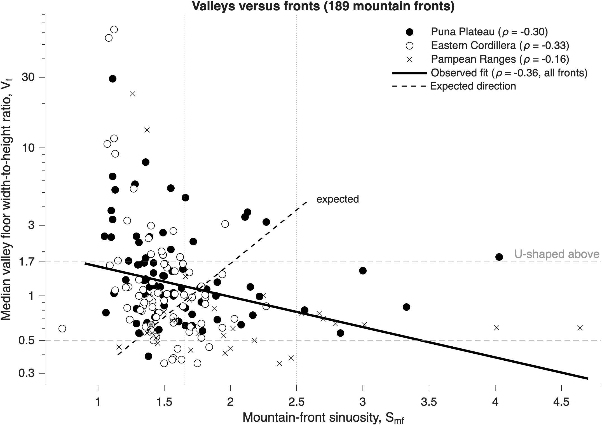

# Reading the Puna
### A reanalysis of H. Daxberger’s mountain-front indices, southern Central Andes

**An interactive reanalysis of how landform shape reveals active faults in the southern Central Andes (23–28° S).**

**[Open the interactive visualizer →](https://gergomesz.github.io/andes-tectonic-reanalysis/)**

This site rebuilds, from first principles, the three geomorphic indices used by Daxberger & Riller (2015, *Geomorphology* 248, 57–76) and re-runs the analysis on the data published in Heidi Daxberger's open-access PhD thesis (McMaster University, 2013). It is a single static page with no build step and no dependencies, ready for GitHub Pages.

> Faults push rock up; rivers and weather wear it down. Where faults are winning, mountain fronts stay straight and valleys stay narrow. Measure those shapes from satellite elevation data and you can map which faults are still moving, without dating a rock.

---

## Contents

| Sheet | What it does |
|---|---|
| 01 Reading the Puna | Schematic W–E section of the Andes at ~25° S: Western Cordillera, Puna Plateau, Eastern Cordillera, Pampean Ranges, bivergent reverse faults. |
| 02 Mountain-front sinuosity | Interactive. Erosion carves embayments into a fault-bounded front; S<sub>mf</sub> = L<sub>mf</sub>/L<sub>s</sub> is computed live from the drawn line and classified with Daxberger's thresholds. |
| 03 Valley shape | Interactive. Trade uplift against lateral widening; V<sub>f</sub> = 2V<sub>fw</sub> / [(E<sub>ld</sub>−E<sub>sc</sub>)+(E<sub>rd</sub>−E<sub>sc</sub>)] updates with dimensioned drawing. |
| 04 Basin symmetry | Interactive. Tilt a basin and add rock-strength noise; shows why per-transect T-vectors can be large while their mean goes to zero. |
| 05 Calibration | Real data. S<sub>mf</sub> of the 78 fronts on dated faults, grouped by the epoch in which faulting began, with Spearman ρ per province. |
| 06 All 189 fronts | Real data. Dot histogram of S<sub>mf</sub> by province with class boundaries and a class-count table (with the Table 4.1 / 4.2 discrepancy flagged). |
| 07 Valleys versus fronts | Real data. Median V<sub>f</sub> against S<sub>mf</sub> for all 189 fronts: an open question (see below). |
| 08 Tilt directions | Real data. Area-proportional rose diagrams of T-vector azimuths for 3,354 basins. |
| 09 First-order basins | The four alluvial-fan / drainage-migration patterns Daxberger used on 32 intermontane basins. |
| 10 What it means | In-sequence vs out-of-sequence wedge; her conclusions, the reanalysis, data notes, sources. |

## The indices

| Index | Definition | Reads as | Thresholds used |
|---|---|---|---|
| Mountain-front sinuosity | S<sub>mf</sub> = L<sub>mf</sub> / L<sub>s</sub> (Bull & McFadden 1977) | straight front → recent fault slip | Class 1 ≤ 1.65 (Holocene), Class 2 1.66–2.5 (late Neogene–Holocene), Class 3 > 2.5 (Neogene and older) |
| Valley floor width / height | V<sub>f</sub> = 2V<sub>fw</sub> / [(E<sub>ld</sub>−E<sub>sc</sub>)+(E<sub>rd</sub>−E<sub>sc</sub>)] (Bull 1977) | narrow V → incision keeping up with uplift | V ≤ 0.5, intermediate 0.5–1.7, U > 1.7 (median per basin, sampled every 150 m) |
| Transverse topographic symmetry | T = D<sub>a</sub> / D<sub>d</sub> (Cox 1994) | stream displaced from midline → possible tilt | vector magnitude 0–1 with azimuth; Curry (1956) test for a preferred direction |

Daxberger extracted these from SRTM (90 m, cubically resampled to 30 m) with the ArcGIS ValleyMorph / River Transect Tool (Daxberger et al. 2014). She rejected the 30 m ASTER GDEM because it contained ~3.5 million undefined-flow cells against ~0.5 million for SRTM. Mountain fronts were taken where hillslope exceeds 12.5°, in segments >5 km long whose strands differ in trend by <10°.

## Data provenance

All numbers come from the open-access thesis: Daxberger, H. (2013), *Tectonomorphologic and kinematic characterization of Neogene deformation in the southern Central Andes (23°–28°S, NW Argentina)*, PhD thesis, McMaster University, [hdl:11375/13458](http://hdl.handle.net/11375/13458).

| File | Source | Rows |
|---|---|---|
| `data/mountain_fronts.csv` | Thesis Table 4.1 (PDF pp. 191–194) | 189 fronts: province, segment ID, fault type, age, sources, trend, S<sub>mf</sub>, N basins, V<sub>f</sub> median/min/max, class, domain |
| `data/t_factor_by_province.json` | Thesis Table 4.A1 (PDF pp. 204–229) | Per-province summaries of 3,354 basin T-vectors (azimuth histograms, R histograms, mean vectors, V<sub>f</sub> quartiles) |
| `data/basins.csv` | Thesis Table 4.A1 | Written by `scripts/extract_thesis_tables.py` when you run it on the PDF (one row per basin) |

**Validation.** The 189-front table was parsed from the PDF text layer and checked against column sums computed directly from the PDF (S<sub>mf</sub>, V<sub>f</sub> median/min/max, trend, N, class and domain sums all match). For Table 4.A1, every one of the 189 fronts has exactly as many basin rows as its N in Table 4.1 (3,354 in total).

Fault-type codes: 1 reverse, 2 inferred reverse, 3 normal, 4 inferred normal, 5 strike-slip, 6 inferred strike-slip, 7 photolineament. Source codes follow the thesis' Table 4.1 footnote (e.g. 11 = Coutand et al. 2001, 17 = Strecker et al. 2007, 21 = Schoenbohm & Strecker 2009).

## Reanalysis

`scripts/reanalysis.py` reproduces every number on the site and writes `analysis/results.json`.

**1. Does S<sub>mf</sub> track fault age?** Yes, moderately. Fault ages are published as epoch ranges, so each dated front is ranked by the epoch in which faulting began (Holocene = 0 … Eocene = 5).

| Subset | n | Spearman ρ | p |
|---|---|---|---|
| All provinces | 78 | 0.35 | 0.002 |
| Puna Plateau | 30 | 0.55 | 0.002 |
| Eastern Cordillera | 39 | 0.17 | 0.32 |
| Pampean Ranges | 9 | 0.66 | 0.05 |

Fronts whose faults remain active into the Quaternary/Holocene have median S<sub>mf</sub> 1.40 (n = 46) against 1.59 (n = 32) for faults that stopped earlier (one-sided Mann–Whitney p = 3×10⁻⁴). The proxy holds well on the Puna and weakly in the Eastern Cordillera, where several Eocene–Miocene faults have straight fronts. That is consistent with her observation that geomorphic classes often record *younger* activity than stratigraphic ages.

**2. V<sub>f</sub> against S<sub>mf</sub> (an open question).**



*Graph 7, produced in MATLAB by `scripts/graph7_valleys_vs_fronts.m`.*

 The classic model predicts that active fronts have both low S<sub>mf</sub> and low V<sub>f</sub> (a positive relation). In the per-front medians the relation is **negative**: Spearman ρ = −0.36 (p < 10⁻⁶, n = 189). Median V<sub>f</sub> is 1.10 for Class 1 fronts, 0.82 for Class 2 and 0.73 for Class 3. The thesis states that V<sub>f</sub> does not track fault age (reproduced: ρ = 0.07, p = 0.56) and bases the S<sub>mf</sub>–V<sub>f</sub> link on map-view patterns. Candidate explanations to test:
- V<sub>f</sub> is sampled along each whole tributary every 150 m, not only near the front.
- Resampled 90 m SRTM cannot resolve narrow valley floors, which compresses low V<sub>f</sub>.
- Aggradation in active, internally drained plateau basins widens valley floors.
- Province effects: the Pampean Ranges combine high S<sub>mf</sub> with narrow valleys. Within-province ρ is still negative (Puna −0.30, Eastern Cordillera −0.33).

**3. Is there a preferred tilt direction?** No. Because tributary basins run roughly E–W, T-vectors point N or S. The north share is 52.8 % (Puna, binomial p = 0.05), 48.9 % (Eastern Cordillera, p = 0.45) and 49.6 % (Pampean Ranges, p = 0.84). A typical basin is noticeably asymmetric (mean |T| ≈ 0.21–0.24), but the asymmetry cancels across basins. This supports her conclusion that basin asymmetry reflects local erodibility, not tectonic tilt. Caveat: neighbouring basins are not independent, so these p-values understate the uncertainty.

## Questions to ask

Open questions for Professor Daxberger. The answers will be added here (and in `scripts/reanalysis.py`, which feeds the website) after speaking with her.

1. **Segment 196** in the Eastern Cordillera has an S<sub>mf</sub> of 0.73. How can S<sub>mf</sub> be below 1 for this segment?
   *Answer: to be added.*
2. **Province-mean T:** the thesis reports 0.04 / 0.03 / 0.01; the vector mean of the per-basin values gives 0.017 / 0.020 / 0.005. How were the province averages calculated?
   *Answer: to be added.*
3. **Vf against Smf:** across all 189 fronts, median V<sub>f</sub> falls as S<sub>mf</sub> rises (ρ = −0.36), the opposite of the Bull & McFadden expectation. What explains this?
   *Answer: to be added.*
4. **Choosing a research topic:** how did you choose the topic for your PhD, and how would you advise a student to choose a topic for a master's or PhD?
   *Answer: to be added.*

**To add an answer:** open `scripts/reanalysis.py`, find the matching question in section 5, and put the answer in its `"answer"` field (or edit `analysis/results.json` and `assets/data.js` directly), then rerun `python scripts/reanalysis.py`.

The published *Geomorphology* paper may contain revised values; this reanalysis uses the thesis tables, which are the openly available version.

## Run it

```bash
# view the site
python -m http.server 8000         # then open http://localhost:8000
# (or just open index.html; data is embedded in assets/data.js)

# reproduce the numbers
pip install -r requirements.txt
python scripts/reanalysis.py        # writes analysis/results.json and assets/data.js

# Graph 7 in MATLAB (R2018b or newer): open the script and press Run
#   scripts/graph7_valleys_vs_fronts.m

# rebuild the data from the thesis PDF
python scripts/extract_thesis_tables.py Daxberger_2013_PhD_thesis.pdf
```

**Deploy:** push to GitHub, then Settings → Pages → *Deploy from a branch* → `main` / root. The `.nojekyll` file makes Pages serve the files as-is.

## Repository layout

```
index.html                     the site (10 sheets)
assets/style.css               drafting-sheet styles, light and dark
assets/app.js                  interactive plates and charts (plain SVG, no libraries)
assets/data.js                 generated: data + results embedded for the page
data/mountain_fronts.csv       thesis Table 4.1
data/t_factor_by_province.json thesis Table 4.A1, summarised
scripts/extract_thesis_tables.py  PDF → CSV, with validation
scripts/reanalysis.py          statistics → analysis/results.json, assets/data.js
scripts/graph7_valleys_vs_fronts.m  MATLAB version of Graph 7 (no toolboxes needed)
analysis/graph7.png            Graph 7 exported from MATLAB
analysis/results.json          every number quoted on the site
```

## References

- Daxberger, H., Riller, U. (2015). Analysis of geomorphic indices in the southern Central Andes (23°–28°S): Evidence for pervasive Quaternary to Recent deformation in the Puna Plateau. *Geomorphology* 248, 57–76. https://doi.org/10.1016/j.geomorph.2015.07.016
- Daxberger, H. (2013). *Tectonomorphologic and kinematic characterization of Neogene deformation in the southern Central Andes (23°–28°S, NW Argentina).* PhD thesis, McMaster University. http://hdl.handle.net/11375/13458
- Daxberger, H., Dalumpines, R., Scott, D.M., Riller, U. (2014). The ValleyMorph Tool: An automated extraction tool for transverse topographic symmetry (T-) factor and valley width to valley height (Vf-) ratio. *Computers & Geosciences* 70, 154–163. https://doi.org/10.1016/j.cageo.2014.05.015
- Daxberger, H., Riller, U. (2015). Kinematics of Neogene to Recent upper-crustal deformation in the southern Central Andes (23°–28°S) inferred from fault–slip analysis: Evidence for gravitational spreading of the Puna Plateau. *Tectonophysics* 642, 16–28. https://doi.org/10.1016/j.tecto.2014.12.003
- Bull, W.B. (1977). The alluvial-fan environment. *Progress in Physical Geography* 1, 222–270.
- Bull, W.B., McFadden, L.D. (1977). Tectonic geomorphology north and south of the Garlock fault, California. In Doehring, D.O. (ed.), *Geomorphology in Arid Regions*, 115–138.
- Cox, R.T. (1994). Analysis of drainage-basin symmetry as a rapid technique to identify areas of possible Quaternary tilt-block tectonics. *GSA Bulletin* 106, 571–581.
- Curry, L. (1956). The analysis of spatial distributions. *Geografiska Annaler* 38.

## Credits and licence

Site and reanalysis by **Gergo Meszaros**. This is an independent study project. It is not affiliated with or endorsed by the original authors, and any errors in the reanalysis are mine.

Code (`index.html`, `assets/`, `scripts/`) is released under the MIT licence (see `LICENSE`). The data in `data/` are transcribed from Daxberger (2013) and remain the work of the original author. They are reproduced here for scholarly reuse with attribution; please cite the thesis and the 2015 paper when using them.
